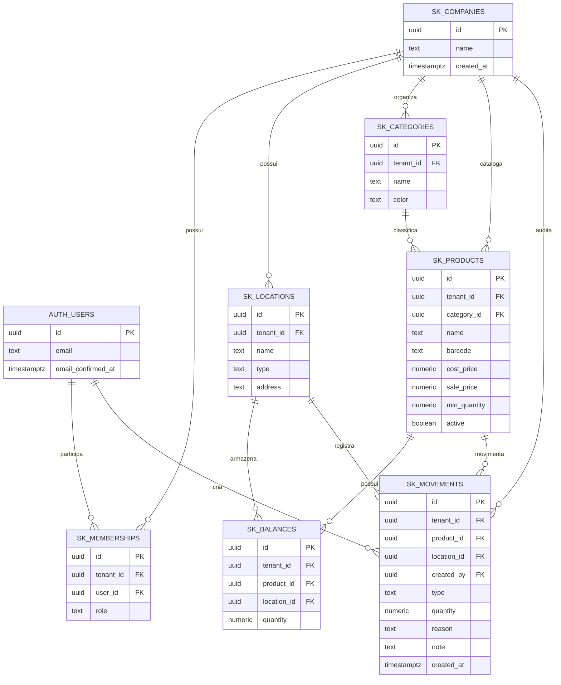

# DER do Stockinho

O diagrama representa o banco utilizado pelo sistema. As tabelas `auth.users` e as funções de autenticação pertencem ao Supabase; as tabelas `sk_*` são criadas por `schema.sql`.

As chaves estrangeiras compostas `(tenant_id, category_id)`, `(tenant_id, product_id)` e `(tenant_id, location_id)` impedem relações entre empresas diferentes. A RLS usa a associação em `sk_memberships`; `admin` gerencia cadastros e `operator` consulta e registra movimentações.
